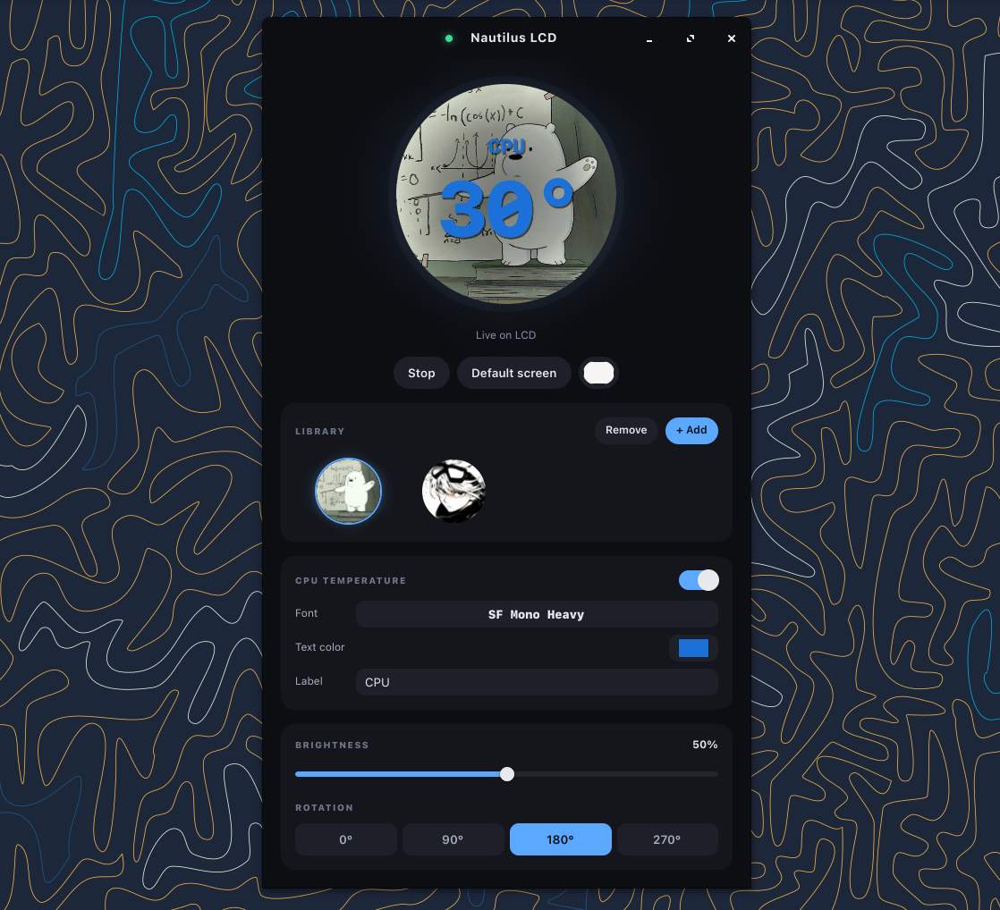

# nautilusLCD

Linux controller for the **Corsair Nautilus LCD Cap** (`1b1c:0c57`), written in C.
Talks directly to the device through `/dev/hidraw`; no iCUE needed.



## Features

- Images and animated GIFs on the 480x480 round LCD
- CPU temperature screen: any font, text color and label, over an image/GIF or a solid color
- Brightness and rotation
- Background service that keeps the screen alive and restores it on login
- GTK 4 window and a command line

Tested on firmware 0.3.0.5, Arch Linux, Intel CPU (`coretemp`).

## Install

```bash
sudo pacman -S --needed base-devel libjpeg-turbo libpng giflib gtk4
make install
systemctl --user enable --now nautilusctld

# allow your user to access the LCD (once)
sudo install -Dm644 udev/70-nautilusctl.rules /etc/udev/rules.d/70-nautilusctl.rules
sudo udevadm control --reload-rules && sudo udevadm trigger --action=add --subsystem-match=hidraw
```

## Usage

Open **Nautilus LCD** from the app menu, or use the terminal:

```bash
nautilusctl show image.gif
nautilusctl cpu font="JetBrains Mono Bold" fg=#5aa9ff label=CPU image=anim.gif
nautilusctl brightness 70
nautilusctl rotation 2        # 0, 90, 180, 270 degrees
nautilusctl status | stop | hardware
```

## How it works

`nautilusctld` is a `systemd --user` service and the only process that talks to the LCD:
the firmware returns to its default screen when frames stop, so something must keep sending
them. The window and the CLI are clients that send commands over a Unix socket.

The packet format was learned from the open source
[OpenLinkHub](https://github.com/jurkovic-nikola/OpenLinkHub) driver; no code was copied.

> Not affiliated with Corsair. Provided as-is, without warranty.

## License

GPL-3.0-or-later. See [LICENSE](LICENSE).
